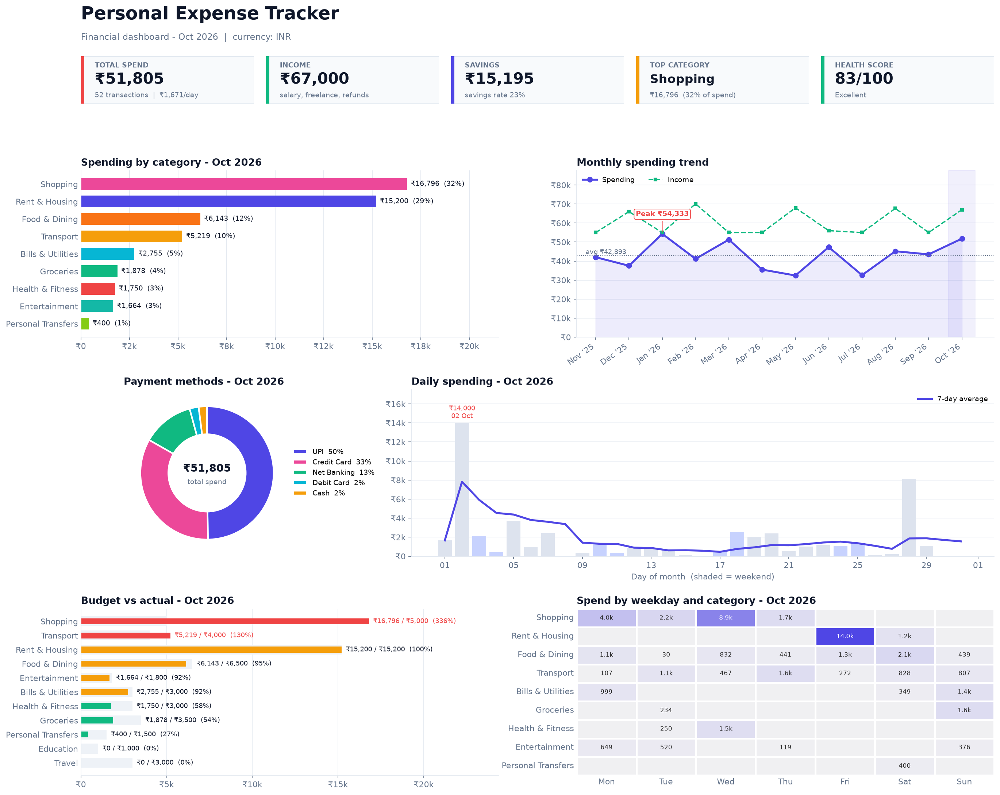
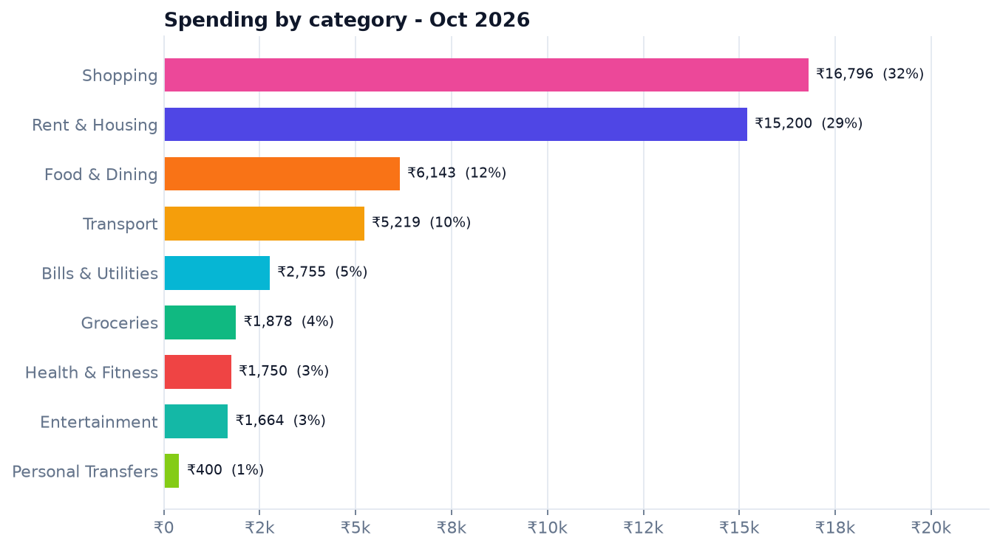
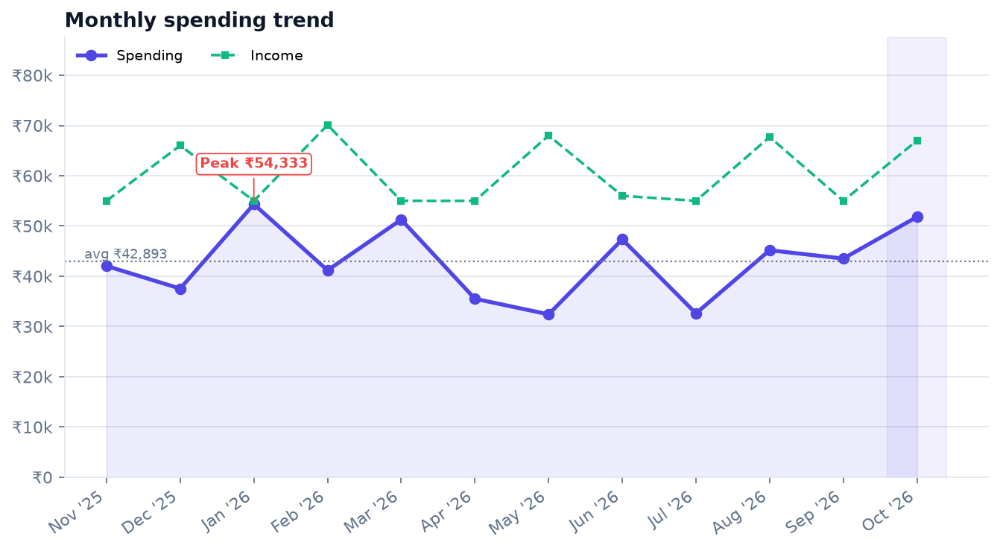
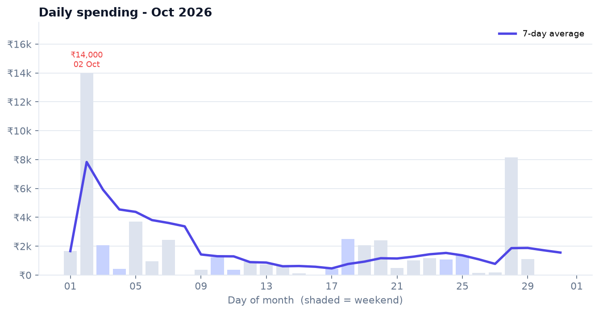
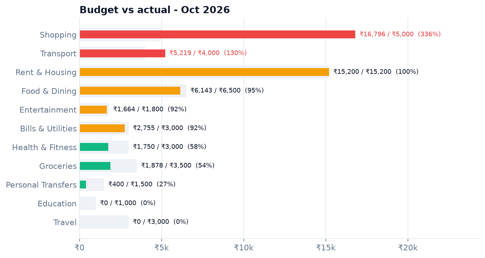
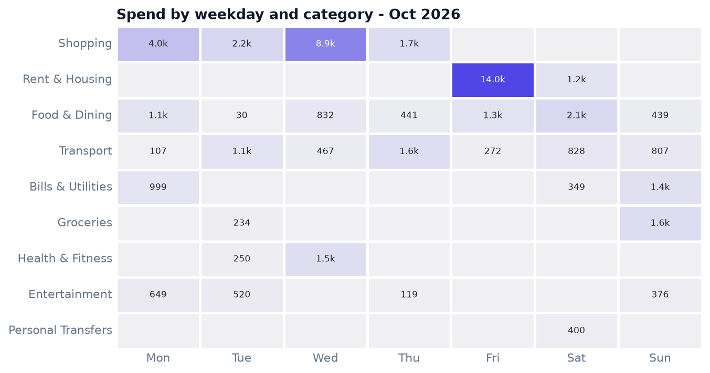
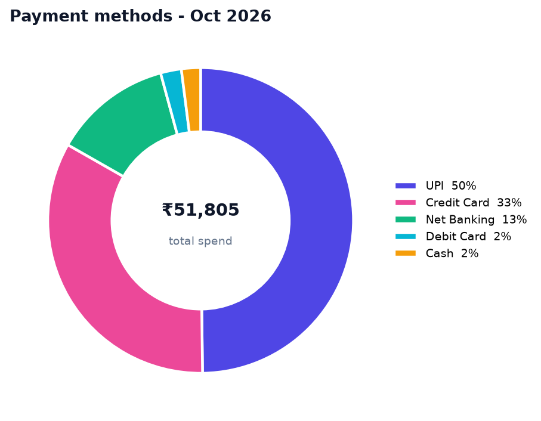
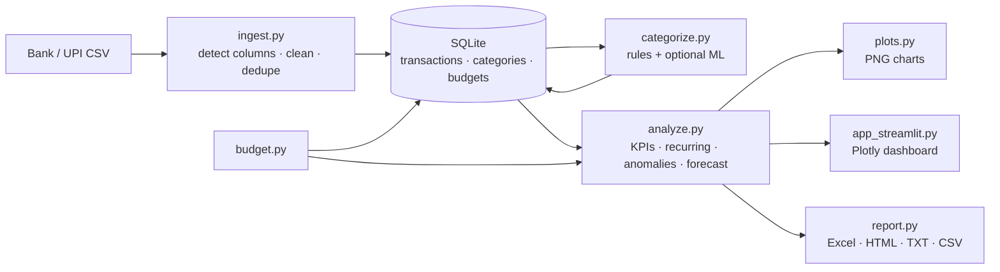

# 💸 Personal Expense Tracker with Data Visualization

> An end-to-end personal-finance analytics project in Python: **import bank/UPI CSVs → clean → auto-categorize → store in SQLite → analyze → visualize → export reports**, with an interactive Streamlit dashboard.




*One-page dashboard generated by `python main.py run-all` (synthetic data, amounts in INR).*

---

## Why this project?

Bank statements are messy and every bank formats them differently. This project turns them into answers: **where does my money go, am I on budget, what are my hidden subscriptions, and what will next month cost?**
It is built like a small production system (layered modules, a real database schema, idempotent imports, tests, CI) rather than a single script.

## Features

| Area | What it does |
|---|---|
| **Smart ingestion** | Auto-detects columns (`Date / Narration / Withdrawal / Deposit / Amount`), parses `₹1,299.50`, `(500)`, `250 Dr`, mixed date formats, split debit/credit columns, and reports exactly what it cleaned |
| **Data cleaning** | Drops invalid rows, removes duplicates, normalizes whitespace, payment methods (`gpay → UPI`) and category names |
| **Auto-categorization** | Ordered keyword rules (13 categories, Indian merchants), manual overrides that are never overwritten, optional Naive-Bayes fallback |
| **SQLite storage** | Normalized schema, `UNIQUE` constraint → re-importing the same file is safe (idempotent) |
| **Analytics** | KPIs, monthly/category/payment summaries, weekday heatmap, top merchants, month-over-month change |
| **Beyond the basics** | Recurring-payment (subscription) detection · anomaly detection (robust z-score) · next-month forecast · 0-100 financial health score · plain-English insights |
| **Budgets** | Per-category monthly limits, status (On track / Warning ≥80% / Over), alerts, data-driven budget suggestions |
| **Visualization** | 9 static charts (Matplotlib/Seaborn) + interactive Plotly dashboard (8 tabs): filter bar, category drill-down, month-vs-month comparison, what-if savings simulator, zoomable daily chart with range slider, searchable/sortable transactions |
| **Reports** | Formatted Excel workbook with native charts, printable HTML report, text summary, CSV exports |
| **Engineering** | CLI (`main.py`), 15 pytest tests, GitHub Actions CI, Indian number formatting (`₹12,34,567`) |

## Quick start

```bash
git clone https://github.com/<your-username>/Personal-Expense-Tracker-Visualization.git
cd Personal-Expense-Tracker-Visualization
python -m venv .venv && source .venv/bin/activate      # Windows: .venv\Scripts\activate
pip install -r requirements.txt

python main.py run-all        # builds the DB, analysis, charts and reports (≈10 s)
python main.py dashboard      # opens the interactive dashboard in your browser
```

No data of your own? The project ships a **synthetic dataset** (12 months, 4 accounts, ~600 transactions, plus a deliberately messy HDFC-style bank statement). To use your own bank CSV:

```bash
python main.py ingest my_statement.csv --account "HDFC Savings"
python main.py report --month 2026-10
```

## Sample output (Oct 2026, synthetic data)

```
  Total spend          :      ₹51,805
  Income               :      ₹67,000
  Savings              :      ₹15,195   (22.7% savings rate)
  Highest category     : Shopping (₹16,796, 32%)
  Health score         : 83/100 (Excellent)

  ! OVER: Shopping is ₹11,796 over its ₹5,000 budget (336% used).
  ! OVER: Transport is ₹1,219 over its ₹4,000 budget (130% used).
  * 8 recurring payments detected costing about ₹2,42,764 per year
  * Unusual expense: ₹7,999 on 'Amazon.in - Festive Sale Smart Watch' is 5.8x typical Shopping
  FORECAST Nov 2026: about ₹47,991
```

## Visual gallery

| Category spending | Monthly trend |
|---|---|
|  |  |
| **Daily spending** | **Budget vs actual** |
|  |  |
| **Weekday × category heatmap** | **Payment methods** |
|  |  |

> 📸 Add screenshots of the live Streamlit dashboard to `images/` (see [`docs/10_screenshots_checklist.md`](docs/10_screenshots_checklist.md)) and link them here.

## Architecture



## Project structure

```
Personal-Expense-Tracker-Visualization/
├── main.py                  # CLI: run-all, ingest, add, budget, analyze, charts, report, dashboard
├── requirements.txt
├── data/                    # sample_expenses.csv, hdfc_statement_nov2026.csv (messy bank export)
├── db/                      # expenses.db is created here (git-ignored)
├── src/
│   ├── config.py            # paths, categories, colours, ₹ formatting
│   ├── models.py            # SQLite schema + connection helper
│   ├── generate_data.py     # realistic synthetic data generator
│   ├── ingest.py            # column detection, cleaning, upsert
│   ├── categorize.py        # rules + optional Naive-Bayes
│   ├── analyze.py           # all analytics
│   ├── budget.py            # limits, status, alerts, suggestions
│   ├── plots.py             # Matplotlib/Seaborn charts
│   ├── report.py            # Excel / HTML / TXT / CSV
│   ├── pipeline.py          # demo pipeline shared by CLI + app
│   └── app_streamlit.py     # interactive dashboard
├── notebooks/01_exploratory_analysis.ipynb
├── tests/                   # 15 pytest tests
├── outputs/                 # CSV summaries + charts (proof of work)
├── images/                  # README images
├── reports/                 # monthly Excel / HTML / TXT reports
└── docs/                    # explanations, simulation, GitHub steps, interview prep
```

## Data model

```
categories(id, name UNIQUE, parent, kind)
transactions(id, tx_date, description, amount, currency, account, payment_method,
             category_id → categories.id, category_source, raw_source, tags, created_at,
             UNIQUE(tx_date, description, amount, account))
budgets(id, month 'YYYY-MM', category_name, limit_amount, UNIQUE(month, category_name))
```
Sign convention: **negative amount = expense, positive = income**. `category_source` records *who* labelled a row (`csv`, `rule`, `ml`, `manual`) so a manual fix is never overwritten.

## Design decisions (and honest limitations)

- **Rules before ML.** Merchant keywords are explainable and cover >99% of the synthetic data; ML is an optional fallback. Its ~98% cross-validation accuracy is inflated because labels come from the rules themselves - treat it as a demo of the technique.
- **Idempotent imports** via a `UNIQUE` key. Trade-off: two genuinely identical same-day, same-amount purchases on one account collapse into one. A real system would use the bank's reference number.
- **Anomalies use median/MAD**, not mean/std, so one huge purchase cannot hide itself by inflating the average.
- **A month is "complete"** only if the data reaches its last calendar day; the latest month is treated as month-to-date so it never looks like a spending crash.
- **Forecast** is a transparent weighted average (50/30/20) of the last 3 complete months with a linear-trend cross-check - not a black box.
- The demo data is **synthetic**; numbers are illustrative, not financial advice.

## Testing

```bash
pip install -r requirements-dev.txt
python -m pytest -q
```
Covers parsing (amounts, ISO vs day-first dates), debit/credit mapping, deduplication, idempotent re-import, rule priority, manual-override protection, KPI maths, recurring/anomaly detection, budget status, forecast, and a full end-to-end pipeline run.

## Roadmap

- [ ] PDF statement parsing (pdfplumber) · [ ] Account Aggregator / bank API import
- [ ] Per-user login · [ ] Goals & savings targets · [ ] Email/WhatsApp budget alerts
- [ ] Docker image · [ ] Deploy on Streamlit Community Cloud

## What I learned

Data cleaning with pandas · schema design & idempotent loads in SQLite · rule-based vs ML classification · robust statistics for anomaly detection · building layered, testable Python code · turning numbers into readable insights.

## License

MIT - see [LICENSE](LICENSE).
